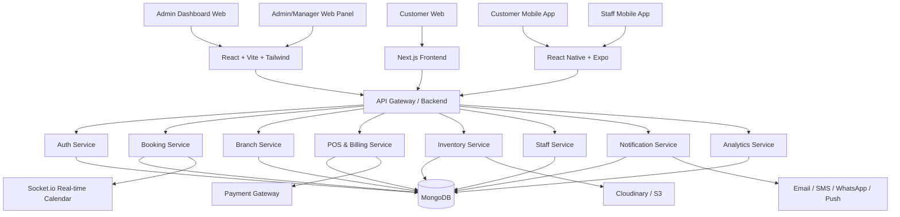

# Salon Management System Project Plan

## 1. Executive Summary

This project is a production-grade multi-branch salon management platform designed for a salon business with multiple physical locations, centralized control, and digital operations across web and mobile. The system will help salon owners manage branches, staff, appointments, inventory, billing, customer history, marketing, and analytics from one platform.

The recommended architecture is a modern full-stack solution using:
- Frontend Web: React + Vite + Tailwind CSS + shadcn/ui
- Customer Website: Next.js
- Mobile Apps: React Native + Expo
- Backend: Node.js + Express.js or NestJS
- Database: MongoDB + Mongoose
- Real-time layer: Socket.io
- Storage: Cloudinary / AWS S3
- Payments: Razorpay / Stripe
- Notifications: Email, SMS, WhatsApp, Push
- DevOps: Docker, GitHub Actions, Vercel/Netlify, Railway/Render/AWS

This is a multi-branch-first business system, not just a booking app. The core business logic must be branch-aware from the beginning.

---

## 2. Business Objective

The platform should help salon owners achieve:
- Centralized control across all branches
- Faster appointment booking and better customer experience
- Improved staff utilization and scheduling
- Reduced manual billing and inventory errors
- Real-time analytics for revenue, trends, and branch performance
- Better loyalty and customer retention

---

## 3. Target Users

### 3.1 Admin / Owner
- Manages all branches
- Sees all revenue, trends, and branch performance
- Creates and manages services, staff, inventory, pricing
- Controls permissions, commissions, discounts, promotions

### 3.2 Branch Manager
- Manages assigned branch
- Handles staff schedules and daily operations
- Reviews branch reports and customer performance

### 3.3 Staff / Stylist / Receptionist
- Views schedules and appointments
- Updates service completion
- Handles POS operations and customer notes

### 3.4 Customer
- Books appointments online
- Views service list by branch
- Tracks booking history and preferences
- Reviews salons and gets reminder notifications

---

## 4. Best Development Priority: Web First, App Later

### Recommendation: Build Web first, then APK/mobile

This is the best approach for a salon business system because:

1. Core business workflows are more complex than UI alone.
   - Booking engine
   - Branch logic
   - Inventory
   - Billing
   - Staff schedules
   - Reports

2. Web app gives faster development and better admin control.
   - Easier for management dashboards, reporting, inventory, and operations
   - Faster debugging with larger screens and easier testing
   - Better for owner and manager-level administration

3. Mobile apps should come after the backend and booking system is stable.
   - Mobile is a thin layer on top of a stable backend.
   - If app is built before the core logic is mature, the project gets messy and expensive.

### Recommended Sequence
Phase 1: Core admin web app + customer website + backend + database + auth
Phase 2: Booking engine + staff panel + POS + inventory
Phase 3: Mobile customer app + staff app
Phase 4: Analytics, loyalty, campaigns, reviews
Phase 5: APK distribution + production hardening

### Reasoning
- Web = foundation for operations and analytics
- Mobile = customer convenience and speed
- Business logic is more important than screen design

### Final recommendation
Start with:
- Admin Dashboard (Web)
- Customer Website (Web)
- Backend APIs
- Booking engine
Then build:
- Customer app
- Staff app
- APK release

---

## 5. System Architecture Overview



---

## 6. Recommended Architecture Pattern

### 6.1 Best-fit approach
Use a modular monolith initially, not a microservice architecture from day one.

Why:
- Salons are operational systems, not extremely large distributed systems at MVP stage
- Faster to build and maintain
- Easier for a small team or solo founder
- Booking, billing, inventory, and auth are tightly coupled

### 6.2 Architecture Layers

#### Client Layer
- Admin dashboard web app
- Customer portal website
- Customer mobile app
- Staff mobile app

#### API Layer
- REST APIs for standard business operations
- WebSocket for live calendar updates, booking actions, and notifications
- Shared validation, auth middleware, and branch access rule checks

#### Application Layer
- Auth service
- Branch management
- Booking engine
- Appointment service
- Inventory service
- POS and invoice service
- Analytics and reporting service
- Notification service

#### Data Layer
- MongoDB collections with branch-aware design
- Redis for caching and rate limiting
- Cloud storage for images and assets

#### Integration Layer
- Payment providers
- Notification providers
- CRM and marketing tools (future)

---

## 7. Tech Stack Recommendation

### 7.1 Frontend Web
- React 18/19
- Vite
- TypeScript
- Tailwind CSS
- shadcn/ui
- TanStack Query
- Zustand
- FullCalendar or custom calendar components

### 7.2 Customer Website
- Next.js 14+
- Tailwind CSS
- SSR/SSG for SEO and performance
- API integration with backend

### 7.3 Mobile Apps
- React Native + Expo
- TypeScript
- React Navigation
- Expo Notifications
- Safe-area + design system

### 7.4 Backend
- Node.js
- Express.js or NestJS
- TypeScript
- Mongoose ODM
- JWT + refresh tokens
- Role-based access control (RBAC)
- Socket.io
- Redis

### 7.5 Database
- MongoDB Atlas or self-hosted MongoDB
- Structured indexes on branchId, staffId, status, date

### 7.6 Storage & Media
- Cloudinary / AWS S3
- Images for salon photos, staff, and product catalogs

### 7.7 Payments & Notifications
- Razorpay / Stripe
- Email: Nodemailer
- SMS: Twilio
- WhatsApp: Business API
- Push notifications: Firebase

### 7.8 DevOps
- Docker + Docker Compose
- GitHub Actions
- Vercel/Netlify for web frontend
- Railway/Render/AWS for backend
- Sentry for monitoring

---

## 8. Core Modules

### 8.1 Authentication & User Management
Roles:
- Super Admin
- Owner
- Manager
- Stylist
- Receptionist
- Customer

Requirements:
- JWT auth + refresh tokens
- Role-based permissions
- Branch-specific access control
- Audit logging for important actions

### 8.2 Salon & Branch Management
- Create salon profile
- Manage multiple branches
- Activate/deactivate branch
- Branch working hours and settings
- Branch-specific service pricing
- Branch-specific staff assignment

### 8.3 Services & Categories
- Global services
- Branch override pricing
- Service duration
- Category-wise lists
- Add-ons and packages

### 8.4 Appointment Scheduling & Booking
- Branch selection during booking
- Real-time slot availability
- Auto conflict prevention
- Staff calendar management
- Booking status: pending, confirmed, completed, cancelled
- Reschedule and cancellation logic

### 8.5 Customer CRM
- Customer profile
- Booking history
- Preferences and allergies
- Notes and service recommendations
- Past branch activity

### 8.6 POS & Billing
- Service bill
- Add retail items
- Tips and discounts
- Membership and package application
- GST/tax support
- Invoice generation
- Return and refund handling

### 8.7 Inventory / Stock Management
- Product tracking per branch
- Purchase logs
- Transfer stock between branches
- Low-stock alerts
- Inventory history

### 8.8 Staff Management
- Staff profiles
- Branch assignments
- Shift schedules
- Commission rules
- Attendance tracking
- Performance reports

### 8.9 Notifications
- Booking confirmation
- Reminder before appointment
- Cancel/reschedule alerts
- Payment confirmation
- Low-stock notification
- Staff notification

### 8.10 Marketing & Loyalty
- Gift cards
- Membership plans
- Loyalty points
- Campaigns and promotions
- Retention reminders

### 8.11 Analytics & Reports
- Revenue analytics
- Appointment trends
- Staff performance
- Branch comparison
- Sales reports
- Top services
- Conversion analytics

### 8.12 Reviews & Ratings
- Ratings after service
- Customer reviews
- Review moderation

---

## 9. Multi-Branch Data Architecture

Important rule: every operational record must be branch-aware.

### Core data concept
Every entity related to operations should include:
- branchId
- salonId
- ownerId
- createdBy
- status

### Recommended collections
- Salon
- Branch
- User
- StaffProfile
- Service
- Category
- Appointment
- ClientProfile
- Product
- ProductStock
- InventoryMovement
- Invoice
- Transaction
- CommissionRule
- Package
- Membership
- GiftCard
- NotificationLog
- Review
- AnalyticsSnapshot

### Example branch-aware indexes
- (branchId, date)
- (branchId, staffId)
- (branchId, status)
- (branchId, customerId)
- (salonId, branchId, createdAt)

### Security rule
Always filter backend queries by branchId and role. Never trust frontend branch selection alone.

---

## 10. Booking Engine Design

This is the most important business-critical module.

### Requirements
- Customer picks salon branch
- Customer picks date and service
- System checks staff availability and branch calendar
- Real-time conflicts are prevented
- Booking is locked during selection to avoid double-booking

### Booking logic flow
1. Customer selects branch
2. System loads available staff and slots
3. Service duration and gaps are calculated
4. Available slots are computed against branch schedule and staff schedule
5. Booking is created in a transaction
6. Appointment is reserved and notifications are sent

### Best practices
- Use a booking lock strategy for slot reservation
- Handle overlaps properly
- Keep daily and weekly calendar generation efficient
- Use optimistic locking for around-the-clock appointment updates
- Keep branch-specific calendars isolated

---

## 11. UI/UX Standard

### Admin UI Goals
- Clean dashboard
- Fast data entry
- Clear branch comparison panels
- Tables with filters and search
- Efficient daily operations

### Customer Website Goals
- Premium salon look and feel
- Strong trust signals
- Easy booking flow
- Simple branch selection
- Mobile-friendly experience

### Mobile App Goals
- Fast booking and checkout
- Minimal taps
- Clear status indicators
- Smart reminders and notifications

### Design Principles
- Light but premium aesthetic
- Warm, luxury salon colors like beige, gold, soft brown, blush, charcoal
- High-quality imagery and service cards
- Consistent use of spacing and typography
- Large touch targets for mobile

### Recommended UI Theme
- Primary: warm beige / champagne / ivory
- Secondary: brown / espresso / dark charcoal
- Accent: gold or rose gold
- Buttons: rounded, soft, premium

---

## 12. Performance Requirements

### Performance Goals
- Page load under 2s for key marketing pages
- Admin dashboard under 1.5s for cached data
- API latency under 250ms for standard queries
- Booking search under 300ms for branch availability
- Real-time updates under seconds

### Best Practices
- Use caching for branch metadata and service catalogs
- Paginate long report tables
- Use React Query or equivalent for server state
- Keep heavy reports async
- Use index-based queries on MongoDB
- Compress images and use CDN/media optimization
- Only send required data per branch role

---

## 13. Security & Compliance

### Must Have
- JWT auth with refresh rotation
- RBAC for role and branch access
- Input validation and sanitization
- Rate limiting
- CORS configuration
- Secure headers
- Audit logs for critical actions
- Payment encryption and tokenization

### Recommended
- 2FA for owner/admin accounts
- IP & device tracking for suspicious activity
- Session expiry rules
- Role matrix enforcement on backend

---

## 14. Monorepo Structure Recommendation

```text
salon-management-system/
├─ apps/
│  ├─ web-admin/
│  ├─ customer-website/
│  ├─ mobile-customer/
│  ├─ mobile-staff/
│  └─ api/
├─ packages/
│  ├─ ui/
│  ├─ config/
│  ├─ types/
│  ├─ utils/
│  └─ validation/
├─ services/
│  ├─ auth/
│  ├─ booking/
│  ├─ billing/
│  ├─ inventory/
│  └─ notifications/
├─ infra/
│  ├─ docker/
│  ├─ k8s/
│  └─ ci-cd/
├─ docs/
├─ .gitignore
├─ package.json
├─ turbo.json
└─ README.md
```

This monorepo setup is ideal for a growing project and fits industry best practices.

---

## 15. MVP Scope (Must Have)

### MVP features
- Multi-branch salon management
- Owner and branch manager login
- Service catalog with branch-level variations
- Customer booking on web
- Staff assignment and availability
- Appointment calendar
- Client history and notes
- Basic POS and invoice generation
- Inventory management
- Email/SMS notifications
- Dashboard and reports

### MVP non-goals
- Complex AI upsell engine
- Complex WhatsApp marketing automation
- Full SaaS multi-tenant infrastructure at v1

---

## 16. Phase-wise Development Roadmap

### Phase 1: Foundation (Weeks 1-4)
- Setup monorepo and project structure
- TypeScript adoption
- Authentication system
- Role model and branch access rules
- Salon and branch CRUD
- Staff assignment to branches
- Service catalog foundation

### Phase 2: Booking Engine (Weeks 5-8)
- Branch-aware booking flow
- Calendar and availability logic
- Slot conflict prevention
- Customer booking website
- Admin/manager booking dashboard

### Phase 3: Operations (Weeks 9-12)
- Client CRM
- POS and billing
- Inventory management
- Staff schedules, attendance, commissions
- Payment processing integration

### Phase 4: Reports & Growth (Weeks 13-15)
- Dashboard analytics
- Branch comparison reports
- Loyalty, membership, gift cards
- Reviews and ratings
- Marketing campaigns

### Phase 5: Mobile + Production (Weeks 16-19)
- Customer app
- Staff app
- APK build and signing
- Performance optimization
- Security review
- CI/CD deployment

---

## 17. What to Add for Industry-Level Quality

These are the additions that make the system feel premium and production-ready.

### 17.1 Strong business features
- Membership plans
- VIP customer preferences
- Automated rebooking suggestions
- Digital receipts
- Multi-payment options
- Loyalty reward management
- Commission dashboards

### 17.2 Operational improvements
- Offline sync for staff app
- Queue management for walk-ins
- Expense tracking
- Staff payroll summary
- Product supplier management
- Photo-based service gallery

### 17.3 Growth features
- AI-based prompt suggestions for upsells
- Customer segmentation
- Campaign analytics
- Review sentiment analysis
- SMS/WhatsApp marketing automation

### 17.4 Product quality features
- Branch switching logic optimization
- Real-time WebSocket event handling
- Smart caching and stale data management
- Better error states and empty states
- Accessibility (WCAG-friendly components)

---

## 18. UI/UX + Product Recommendations

### Best experience for salon users
- Smart booking flow: service -> staff -> slot -> checkout
- Card-based service listing with price, duration, and staff skill tags
- Customer profile page with appointment history and preferences
- Strong admin dashboard for branch metrics
- Minimal friction for staff to check in and complete bookings

### Design quality checklist
- Great mobile responsiveness
- Smooth animations
- Clear status badges for bookings
- Minimal data clutter
- Good empty states
- Intuitive navigation

---

## 19. APK / Mobile App Strategy

### APK status
Yes, Android APK is a valid and useful deliverable after the app is stable.

### Recommended mobile app structure
- Customer app: booking, profile, notifications, history
- Staff app: appointment list, check-in, service completion, POS support
- Admin app: compact dashboard view, reports, order alerts

### Best mobile stack
- React Native + Expo
- Expo EAS Build for Android APK/AAB generation
- Firebase messaging for push notifications

### APK release process
1. Build stable backend and API
2. Build React Native app shell
3. Test on Android devices
4. Sign APK using Android keystore
5. Use Play Store or internal distribution for production

### APK-specific consideration
Do not build APK first unless the login, booking, and branch logic are already validated on the web platform. Mobile is a delivery layer, not the foundation of business logic.

---

## 20. Recommended Project Structure for Development

### Folder / module separation
- auth
- users
- salons
- branches
- services
- appointments
- clients
- inventory
- billing
- staff
- notifications
- analytics
- marketing
- reviews

### Each module should have
- controller/router
- service layer
- validator/schemas
- model/entity
- DTOs
- tests
- docs

This keeps the project scalable and easier to maintain.

---

## 21. Pros and Cons of This Plan

### Pros
- Multi-branch support is built from start, which is a major business advantage
- Web + mobile approach covers all user types
- Modular monolith is faster and safer for MVP
- Proper branch logic prevents future complexity
- React + Next.js + React Native is a strong modern stack
- MongoDB suits flexible salon business data models
- Real-time booking updates improve experience
- Scalable architecture supports future growth

### Cons
- Multi-branch logic adds complexity early
- Real-time availability logic is challenging
- Some features require careful validation and edge-case handling
- Mobile apps require additional QA and release management
- If the app grows without a proper data model, branch logic becomes messy
- Payment and notification integrations can add friction if not planned properly

---

## 22. Final Recommendation

### Best path for success
1. Build web-first (admin + customer website + backend)
2. Validate booking, branch logic, billing, inventory
3. Stabilize core operations and reports
4. Then build customer/staff mobile apps
5. Generate APK only after the app is working reliably

### Best strategic outcome
This is the right route because the system is a business operations platform first, and mobile is a convenience layer on top of it. A luxury salon brand needs a polished, premium-looking web experience and a simple mobile experience, but the real foundation must be reliable business logic.

---

## 23. Suggested Next Action

The next steps should be:
- Finalize scope: single-owner multi-branch vs multi-tenant SaaS
- Decide backend architecture: Express.js or NestJS
- Build monorepo skeleton
- Create authentication and role model
- Design MongoDB schema with branch-aware indexes
- Build appointment engine and calendar logic
- Create Figma wireframes for admin dashboard, customer website, and mobile screens
- Then move into full feature development and APK build

---

## 24. Conclusion

The salon management project is strong and commercially viable because it solves real operational pain points for modern salon businesses. The right architecture is a modular monolith, branch-aware from day one, with a web-first development strategy and a mobile app layer added later. This approach gives the best combination of speed, scalability, maintainability, and business readiness.

This plan should serve as the single source of truth for the development process.
